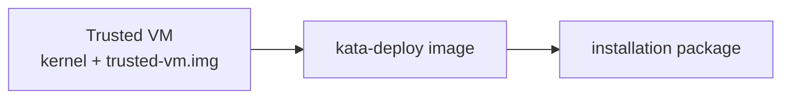
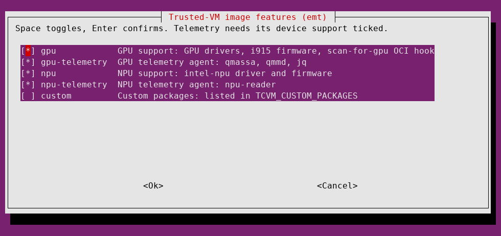

# Build Trusted Compute from Source

[Documentation home](README.md) | [Installation package](trusted_compute_baremetal.md)

This guide explains how to build the Trusted VM, customise its features, build
the kata-deploy image and assemble the installation package. To deploy a
released package instead, follow the [Kubernetes](kubernetes.md) or
[Docker](docker.md) guide.

## Build Overview

| Step | Directory | Build command | Output |
| --- | --- | --- | --- |
| 1. Trusted VM | `trusted-vm/` | `make build` | Guest kernel, kernel config and `trusted-vm.img` in `trusted-vm/build/` |
| 2. kata-deploy image | `trusted-workload/` | `make build` | Docker image `kata-deploy:<version>` |
| 3. Installation package | `baremetal/` | `make build` | `baremetal/out/trusted-compute-installation-package.tgz` |



## Build Host Prerequisites

These requirements apply to the build machine, not to the deployment host.

| Requirement | Notes |
| --- | --- |
| OS | Ubuntu 22.04 or later, x86-64 |
| CPU and memory | 8 or more cores; 4–8 GB RAM minimum, more speeds up the Trusted VM build |
| Storage | At least 256 GB free NVMe or SATA storage |
| Access | `sudo` permission; most targets prompt for the password once |
| Network | Access to GitHub, GitHub Container Registry and Docker Hub. Configure proxies for the shell **and** for the Docker daemon if needed |

Install these tools:

| Tool | Used by |
| --- | --- |
| `git`, `make`, `build-essential`, `curl`, `tar` | All steps |
| Docker Engine (`docker.io` or Docker CE) | All steps |
| [`yq` v4](https://github.com/mikefarah/yq) (Mike Farah) | All steps. `trusted-vm` refuses to start without it |
| `whiptail` or `dialog` | `make menuconfig` only |
| Go 1.21 or later | Local Attestation Manager image only |
| Helm v3 | Installation package |
| containerd `ctr` | Installation package |

The Trusted VM build also runs the Edge Microvisor Toolkit (EMT) image build
on the host. Check the prerequisites in the
[Edge Microvisor Toolkit repository](https://github.com/open-edge-platform/edge-microvisor-toolkit)
if that step fails because of a missing host tool.

## Get the Source

```bash
git clone https://github.com/open-edge-platform/trusted-compute.git
cd trusted-compute
```

## Build the Trusted VM

The Trusted VM is the guest OS that runs every Kata workload. It is built from
the Edge Microvisor Toolkit with the Trusted Compute guest components added.

```bash
cd trusted-vm
make build
```

After a successful build, `trusted-vm/build/` contains:

| File | Purpose |
| --- | --- |
| `vmlinuz-<kernel version>` | Trusted VM guest kernel |
| `config-<kernel version>` | Kernel configuration |
| `trusted-vm.img` | Trusted VM guest image |

The kernel file names must match `kernel.name` and `kernel.config` in
[`trusted-workload/kata-deploy/version.yaml`](../trusted-workload/kata-deploy/version.yaml).
Update `version.yaml` when you move to an EMT release with a different kernel.

## Custom Trusted VM Build

By default the Trusted VM includes every optional feature except custom
packages. To change the selection, create `trusted-vm/.tcvm.config` before
running `make build`.

| Option | Default | Adds |
| --- | --- | --- |
| `TCVM_GPU` | `y` | GPU drivers, i915 firmware and the GPU discovery OCI hook |
| `TCVM_GPU_TELEMETRY` | `y` | GPU telemetry tools; needs `TCVM_GPU=y` |
| `TCVM_NPU` | `y` | Intel NPU driver and firmware |
| `TCVM_NPU_TELEMETRY` | `y` | NPU telemetry tool; needs `TCVM_NPU=y` |
| `TCVM_CUSTOM` | `n` | The packages listed in `TCVM_CUSTOM_PACKAGES` |
| `TCVM_CUSTOM_PACKAGES` | `bc gawk igt-gpu-tools pciutils` | Space-separated package names, used when `TCVM_CUSTOM=y` |

Select the features in an interactive menu:

```bash
cd trusted-vm
make menuconfig
make build
```



Or start from the defaults and edit the file by hand:

```bash
cd trusted-vm
make defconfig
# edit .tcvm.config, for example set TCVM_NPU=n and TCVM_NPU_TELEMETRY=n
make build
```

## Build the kata-deploy Image

The kata-deploy image installs Kata Containers, configured for Trusted Compute,
on the deployment host.

```bash
cd trusted-workload
make build
```

The build packs the Trusted VM kernel and image from `trusted-vm/build/` into
the Kata Containers release and tags the image `kata-deploy:<version>`. If
`trusted-vm/build/` does not exist, it builds the Trusted VM first with the
default features.

## Build the Installation Package

```bash
cd baremetal
make build
```

The package is written to `baremetal/out/trusted-compute-installation-package.tgz`.

> **Note:** The package build pulls **published** images; it does not use images
> built on the local machine. If an image cannot be pulled, the build prints
> `Failed to pull` and continues **without** that image, so check the output
> before using the package.

### Add Locally Built Images to the Package

To package images built on your machine instead of the published ones, build
them and then build the package with `LOCAL_IMAGES=y`. Run these steps from
the repository root.

1. Build the container images:

   ```bash
   make -C trusted-workload build                        # kata-deploy
   make -C attestation-verifier docker-build             # Attestation Verifier images
   make -C attestation-manager build docker-build        # Attestation Manager image
   ```

2. Build the installation package from the local images:

   ```bash
   make -C baremetal build LOCAL_IMAGES=y
   ```

With `LOCAL_IMAGES=y`, every image must exist in the local Docker image store
with the same version as the package; nothing is pulled from the registry. The
build stops with `Local image not found` if any image is missing.

## Clean Up

Run `make -C trusted-vm clean` to remove the Trusted VM sources, rootfs and `trusted-vm/build/`.
