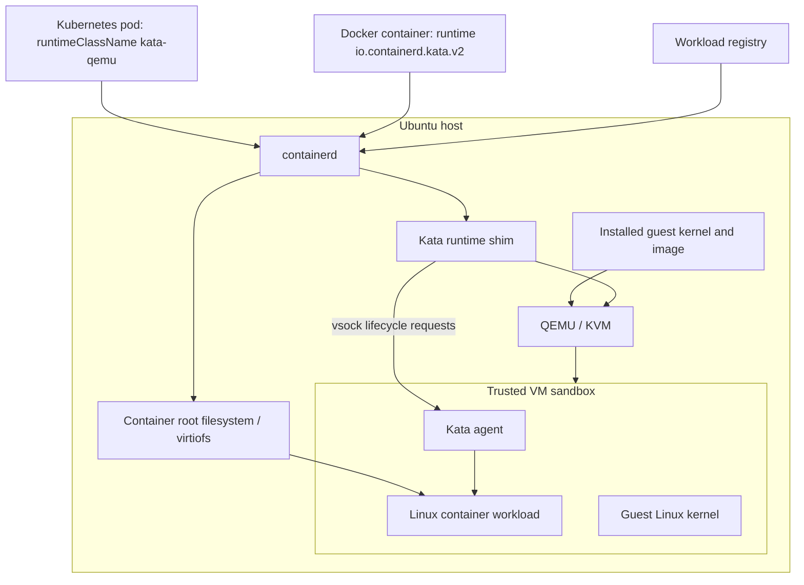
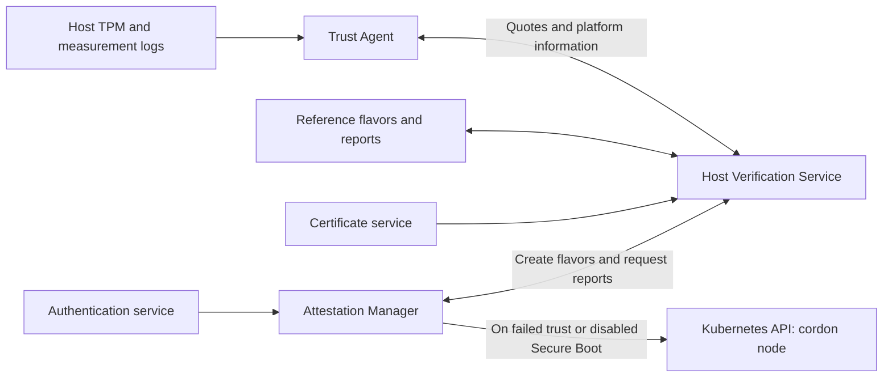

# Trusted Compute Overview

[Documentation home](README.md) | [Next: prerequisites](prerequisites.md)

Trusted Compute provides two complementary capabilities:

- **Host integrity monitoring:** TPM-backed measurements and attestation compare
  the host's measured state with reference measurements.
- **Isolated execution:** Kata Containers runs Linux container workloads in
  QEMU/KVM virtual machines rather than directly sharing the host kernel.

The [deployment model](deployment-options.md) determines which components are
installed. Both models provide isolated execution; the packaged Kubernetes
deployment also provides host integrity monitoring.

## Architecture and Major Components

| Component | Role | Deployment |
| --- | --- | --- |
| `kata-deploy` | Installs the Kata shim, QEMU, guest kernel, VM image and runtime configuration on the host | Kubernetes and Docker |
| Kata runtime shim | Creates and manages a VM sandbox for the container runtime | Kubernetes and Docker |
| Trusted VM | Linux guest built from Edge Microvisor Toolkit artifacts, with the Kata agent and device support | Kubernetes and Docker |
| Kata agent | Receives lifecycle requests over vsock and starts containers inside the guest | Kubernetes and Docker |
| `trusted-workload` chart | Installs the NRI device injector used by the Kubernetes CDI examples | Kubernetes |
| Trust Agent (`trustagent-suefi`) | Reads host platform information, TPM quotes and measurement logs | Kubernetes |
| AAS and AAS database | Authentication and authorization for verifier services | Kubernetes |
| CMS | Certificate management for verifier services | Kubernetes |
| HVS and HVS database | Reference measurements (flavors), host verification and trust reports | Kubernetes |
| Attestation Manager | Registers the host, manages flavors, polls trust reports and restricts scheduling on failure | Kubernetes |

### Host and Trusted VM Architecture

The VM kernel and image are installed by `kata-deploy`; they are not downloaded
as a new VM image for every workload. Workload container images are pulled by
the host container runtime. The shim and guest agent coordinate container
creation and filesystem access.

A Kubernetes pod uses a VM sandbox; containers within that pod share it.
Docker workloads using the Kata runtime get VM-backed isolation through the
container runtime. A Compose project is not itself a single shared VM.

### Host Attestation Architecture

These services run in the Kubernetes `trusted-compute` namespace. This flow is
not part of the Docker installation. No external management plane is required
for the documented standalone workflows.

## Trust Model and Security Properties

The security boundary depends on a correctly provisioned and administered host:

- UEFI Secure Boot checks the host boot chain. TPM measurements provide evidence
  for attestation; a measurement alone is not proof that software is safe.
- Reference flavors must originate from a known-good host. Automatically
  enrolling a compromised state does not make that state trustworthy.
- KVM separates guest execution from ordinary host applications and other
  guests. The host kernel, hypervisor, runtime, administrators, installed guest
  artifacts and relevant device firmware remain trusted.
- Full disk encryption protects stored data when the system is powered off.
  It does not protect data from an administrator on an unlocked host.
- IOMMU/VFIO configuration is essential when assigning PCIe devices to a VM.
  Passthrough changes the trusted device and driver surface.

The default `kata-qemu` configuration is **not** a claim of hardware-encrypted
confidential computing or protection from a malicious host administrator.
Host attestation is not per-workload signature verification, an application
security audit, or an attestation of arbitrary guest contents. Network encryption,
image provenance, secret handling and application authorization remain operator
responsibilities.

See [integrity and attestation flows](capabilities.md) for measurement scope and
failure behavior, and [known limitations](troubleshooting.md#known-limitations)
before using the examples in production.

## Supported Platforms and Operating Systems

The packaged deployment documented here targets **Intel x86-64/amd64 hosts
running Ubuntu 24.04**, with QEMU/KVM and the supplied Linux Trusted VM.
Use Linux container images compatible with that architecture.

The repository does not provide a Windows guest image or a Windows container
launch workflow for these runtimes. Do not substitute a Windows VM image for the
packaged Linux guest. Accelerator support additionally depends on the platform,
firmware and matching host/guest drivers; see the
[platform prerequisites](prerequisites.md).
